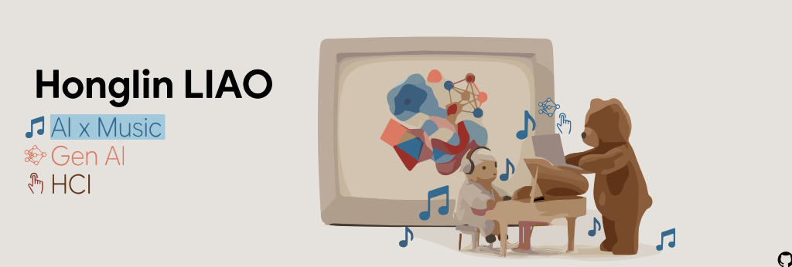
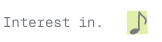

<picture><source media="(prefers-color-scheme: dark)" srcset="./assets/interest-dark.svg"></picture>
<a href="https://lawrenceriver.github.io/" title="Home · Creative portfolio"><picture><source media="(prefers-color-scheme: dark)" srcset="./assets/site-dark.svg"></picture></a>
<a href="https://lawrenceriver.github.io/research/" title="Research · Projects and updates"><picture><source media="(prefers-color-scheme: dark)" srcset="./assets/research-dark.svg"></picture></a><picture><source media="(prefers-color-scheme: dark)" srcset="./assets/research-text-dark.svg"></picture>
<a href="https://lawrenceriver.github.io/bios/" title="Bio · Résumés and background"><picture><source media="(prefers-color-scheme: dark)" srcset="./assets/bios-dark.svg"></picture></a><picture><source media="(prefers-color-scheme: dark)" srcset="./assets/bios-text-dark.svg"></picture>

